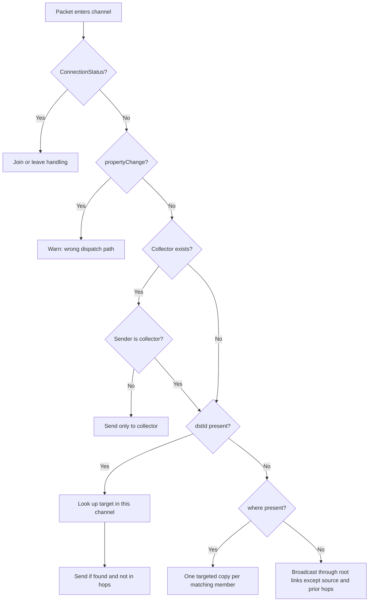

# Routeput Message Routing

Routeput delivers JSON messages between **members of a named channel**. A channel
is a room or topic, a session is a participant, and a `connectionId` identifies
that participant. Participants may be attached locally or reached through another
Routeput server.

This guide describes the current Java implementation, with examples for people
writing clients. It distinguishes ordinary application messages from protocol
messages that the server handles specially.

## Contents

- [Start here: three ways to send](#start-here-three-ways-to-send)
- [The message envelope](#the-message-envelope)
- [Target a group with `where`](#target-a-group-with-where)
- [Routing order and precedence](#routing-order-and-precedence)
- [Collector mode](#collector-mode)
- [Echo, replies, and delivery expectations](#echo-replies-and-delivery-expectations)
- [Membership and channel passwords](#membership-and-channel-passwords)
- [Routing across servers](#routing-across-servers)
- [Properties and routing](#properties-and-routing)
- [Protocol messages that take a different path](#protocol-messages-that-take-a-different-path)
- [HTTP routing](#http-routing)
- [Diagnostics and troubleshooting](#diagnostics-and-troubleshooting)
- [Implementation map](#implementation-map)

## Start here: three ways to send

For ordinary application traffic, choose one of these:

| Goal | Metadata to include | Result without a collector |
| --- | --- | --- |
| Tell the room | `channel` | Broadcast to other members, through their direct links. |
| Tell one member | `channel`, `dstId` | Deliver to that member only. No broadcast fallback. |
| Tell a group selected by properties | `channel`, `where` | Expand into one targeted copy per matching member. |

**Collector mode overrides these choices for messages from non-collectors.**
See [Collector mode](#collector-mode).

The examples below assume the sender has connected and joined `workshop`.
Always include the channel name explicitly in packets sent over a raw WebSocket
or through the browser connection's `transmit` method.

### 1. Broadcast to the channel

```json
{
  "text": "The workshop is starting",
  "__routeput": {
    "channel": "workshop",
    "type": "chat"
  }
}
```

With no `dstId` and no `where`, other channel members receive the message.
Ordinary broadcasts exclude the sender and the link that represents the sender.
Members behind another server receive it through that server's link.

`chat` is an application-defined type, not a special server command. An ordinary
message can also omit `type`.

### 2. Send to one member

```json
{
  "text": "Your station is ready",
  "__routeput": {
    "channel": "workshop",
    "dstId": "stationA",
    "type": "chat"
  }
}
```

The target must be known as a member of **that channel**. Knowing its
`connectionId` from another channel is not enough. If the target cannot be found,
the free-for-all channel logs a lost-packet warning; it does not tell everyone
else instead. A target already listed in `hops` is skipped.

### 3. Send to members whose `x` property is `true`

```json
{
  "command": "refresh",
  "__routeput": {
    "channel": "workshop",
    "where": {
      "x": true
    }
  }
}
```

This selects members whose **session properties** contain `"x": true`.
It does not inspect the application payload or channel properties.

## The message envelope

Application data stays at the top level. Routeput metadata goes inside the
`__routeput` JSON object:

```json
{
  "text": "Hello",
  "__routeput": {
    "channel": "workshop",
    "srcId": "stationA",
    "dstId": "stationB",
    "type": "chat",
    "msgId": "exampleMessage",
    "hops": ["environmentA"]
  }
}
```

| Field | Meaning and practical advice |
| --- | --- |
| `channel` | Channel name as a string. Use it on ordinary routed messages. |
| `srcId` | Original sender's `connectionId`. The WebSocket server fills it if absent. Ordinary clients should let their library/server fill it. Relays preserve it. |
| `dstId` | One recipient's `connectionId`. Omit it for broadcast or `where` fan-out. It is not a channel name or a list of recipients. |
| `where` | A JSON object that selects session properties when the packet reaches the broadcast layer. |
| `type` | Application label or reserved protocol type. Reserved types change dispatch behavior. |
| `msgId` | Message identifier. `RoutePutMessage` generates one if missing. Not an automatic delivery receipt or deduplication key. |
| `ref` | Identifier of a message being answered. Protocol replies use the request's `msgId`. |
| `hops` | Array of environment IDs used by relays for tracing and loop avoidance. Normally leave it to Routeput. |
| `echo` | `true` asks the directly attached server WebSocket to send the packet back after ordinary channel handling. |

Leave optional routing fields **absent** when unused. Do not substitute JSON
`null`, an empty string, an array of IDs, or a wildcard: routing branches often
test whether a field exists, not whether its value is useful.

In the browser library:

```javascript
conn.transmit({
    text: "Hello",
    __routeput: { channel: "workshop", type: "chat" }
});

conn.transmit({
    command: "refresh",
    __routeput: { channel: "workshop", where: { x: true } }
});
```

`RouteputConnection.transmit` fills a missing `srcId`, but does **not** fill
`channel`. A browser `RouteputChannel.transmit` supplies its channel and sender;
a `RouteputRemoteSession.transmit` supplies its channel and target.

## Target a group with `where`

### One input packet becomes a bundle of targeted deliveries

Suppose the channel has these session properties:

| Member | Properties | Matches `{"x": true}`? |
| --- | --- | --- |
| `stationA` | `{"x": true, "role": "display"}` | Yes |
| `stationB` | `{"x": false, "role": "display"}` | No |
| `stationC` | `{"x": true, "role": "sensor"}` | Yes |
| `stationD` | `{"role": "display"}` | No: `x` is missing |

The server removes `where` from the input packet and makes a copy for each
match. The deliveries look like this (server-added hop history omitted):

```json
{
  "command": "refresh",
  "__routeput": {
    "channel": "workshop",
    "srcId": "controller",
    "msgId": "refreshRequest",
    "dstId": "stationA"
  }
}
```

```json
{
  "command": "refresh",
  "__routeput": {
    "channel": "workshop",
    "srcId": "controller",
    "msgId": "refreshRequest",
    "dstId": "stationC"
  }
}
```

Think of this as a **logical bundle of unicasts**, not a new wire format:

- Each match gets a separate JSON message, not an array or a `type: "bundle"`.
- Payload, `srcId`, and `msgId` are preserved across copies.
- Each copy has its own recipient in `dstId`; `where` is gone.
- Remote members are eligible too; their targeted copies go through their
  parent links. The next environment routes by `dstId`, rather than evaluating
  the filter again.
- No matches means no deliveries. There is no fallback broadcast.
- Fan-out uses parallel iteration: there is no recipient ordering, aggregate
  acknowledgement, or all-or-nothing transaction.

### Filter matching rules

Every field in the filter is required: multiple fields mean **AND**.
Extra properties on a member are allowed.

```json
{
  "command": "refresh",
  "__routeput": {
    "channel": "workshop",
    "where": {
      "x": true,
      "role": "display",
      "location": { "floor": "ground" },
      "capabilities": ["screen", "audio"]
    }
  }
}
```

This requires:

- `x` equal to the boolean `true`;
- `role` equal to the string `"display"`;
- a `location` object containing `"floor": "ground"`;
- a `capabilities` array containing both `"screen"` and `"audio"`.

Nested objects match recursively. Arrays are containment filters: every
requested element must be represented in the member's array; extra elements
and a different order are allowed. Object/array elements in arrays are matched
recursively too. Arrays do **not** mean "any of these alternatives."

Scalar values use Java equality: `true` is not `"true"`, and `"Display"` is not
`"display"`. Numeric Java representations can matter, so do not assume an integer
and a floating-point value compare equal.

There is no query language: no `$or`, `$gt`, regular expressions, wildcards, or
automatic dotted-path lookup. Use nested objects, not `"location.floor"`, to
match a nested property. An empty filter `{}` matches every member, but delivery
still excludes the sender, links containing the sender, and prior hops (and
honors the blob opt-out for blob broadcasts).

### Important differences from ordinary broadcast

`where` fan-out excludes the sender even if its properties match. It also
excludes links containing that sender, so a relayed packet is not targeted back
at its originating link. Like ordinary broadcast, members whose own IDs appear
in `hops` are excluded.

Unlike ordinary broadcast, filtered fan-out does **not** have a root-link-only
restriction: other matching remote members still receive individually targeted
copies, including members reached through the sender's parent link.

If `dstId` is present, ordinary channel routing chooses that target first:
`where` does not narrow or validate the target. It is only consumed when
`broadcast` actually runs.

Properties are matched against the channel's current local view. In a
federation, allow time for property updates and membership announcements to
propagate before relying on a newly changed filter.

## Routing order and precedence

For a directly attached WebSocket, the server:

1. Parses a JSON object and handles handshake/property-change traffic specially.
2. Fills `srcId` if missing. If it differs from the socket's ID, it treats the
   packet as relayed traffic for a known remote session.
3. Processes inline `setSessionProperty` directives for direct traffic.
4. Handles reserved control types locally. Ordinary messages with `channel`
   enter `RoutePutChannel.onMessage`; ordinary messages without it are logged
   as lost.

At the channel, it checks that the packet names that channel, performs logging
and receive accounting, appends this environment's hop ID, and consumes inline
property directives. Then it makes the routing decision:



Channel message listeners run after the routing decision, including decisions
that deliver to no network recipient. They are local Java callbacks, not extra
channel members. Error/info/warning traffic may also be mirrored to the debug
channel.

## Collector mode

A collector is a channel member acting as an application authority: for
example, a moderator, game coordinator, or command dispatcher.

| Sender | Destination fields | What the channel does |
| --- | --- | --- |
| Non-collector | Any, including `dstId` or `where` | Sends only to the collector; adds `collectorAbsorbed: true`. |
| Collector | `dstId` present | Sends to the known target unless its ID is in `hops`; adds `collectorTargeted: true`. |
| Collector | No `dstId` | Uses broadcast (including `where` if present); adds `collectorBroadcast: true`. |

For absorbed traffic, the channel marks the original message but does not
automatically replace its `dstId` with the collector's ID. The collector should
interpret the requested destination and decide what to send next.

To request collector status:

```json
{
  "__routeput": {
    "channel": "workshop",
    "type": "request",
    "request": "becomeCollector",
    "msgId": "collectorRequest"
  }
}
```

`becomeCollector` and `dropCollector` operate on the WebSocket's **default
channel**, not an arbitrary channel selected by the request's `channel` field.
The response's `collector` boolean reports the resulting status. A collector
can also be requested by the connection URL's `/collector` token or the
handshake's `collector` flag. An occupied collector slot is not replaced by
these requests; removing the collector member clears the slot.

Collector routing is implemented locally in each channel environment. Do not
assume it establishes a globally elected authority across federated servers.
Membership and property-change notifications use their own paths rather than
being absorbed like application messages. Blob data also bypasses this decision.

## Echo, replies, and delivery expectations

### Echo is a convenience, not a receipt

```json
{
  "text": "Show this locally too",
  "__routeput": {
    "channel": "workshop",
    "echo": true
  }
}
```

After ordinary direct WebSocket channel handling, the socket sends the packet
back to its sender with `echo` removed. It is the packet **after** channel
processing: consumed property directives and `where` may be gone, and hop or
collector metadata may have been added.

This does not prove that any other member received or processed it. It can
occur even when a target was not found. It is not a general echo facility for
HTTP, protocol requests, blob chunks, or remote-session dispatch. `where`
fan-out never targets the sender, but explicit `echo: true` still requests this
separate local return.

### Application replies

To answer another client, send an ordinary application packet with the same
channel and `dstId` set to the original `srcId`. Include `ref` if your
application uses correlation:

```json
{
  "result": "ready",
  "__routeput": {
    "channel": "workshop",
    "srcId": "stationA",
    "dstId": "controller",
    "type": "commandResult",
    "ref": "refreshRequest"
  }
}
```

Do not use the reserved `type: "response"` for normal client-to-client replies:
direct WebSocket protocol responses are handled locally, not routed like
application traffic.

Routeput's ordinary routing does not supply retries, offline delivery, delivery
receipts, or exactly-once semantics. Hop history helps avoid loops; `msgId`
alone does not suppress duplicates. Add application-level acknowledgements and
timeouts where needed.

## Membership and channel passwords

One connection can join multiple channels. Its default channel is selected by
the URL/handshake, but ordinary packets still name the channel they belong to.
Use subscribe/unsubscribe requests to manage additional memberships:

```json
{
  "__routeput": {
    "type": "request",
    "request": "subscribe",
    "channel": "workshop",
    "password": "example-channel-password",
    "msgId": "joinRequest"
  }
}
```

Omit `password` on an open channel. Successful subscription replies use
`type: "response"`, `response: "subscribe"`, and `ref: "joinRequest"`, and include
channel properties and a blob list. An authentication rejection is an `error`
with `authRequired: true`, the channel, and the correlated `ref`.

The WebSocket handshake and the channel's `ConnectionStatus` join path also
check channel passwords. A previously unused channel can adopt the first
supplied password; an existing open channel cannot be claimed this way.
Passwords are stored separately from public channel properties.

Membership announcements use the exact, case-sensitive type
`"ConnectionStatus"` with `srcId`, `channel`, `connected`, and session
`properties`. A joining direct link receives announcements for existing
members. Clients use those IDs and properties for targeting.

The handshake also supplies an authoritative `channelMembers` array so
reconnecting clients can prune stale members. Periodic `memberSync` packets
repair missed leave announcements on existing links. Each sync describes the
children that its receiving link should know, not an unrestricted instruction
to delete every other member. `memberSyncSecs` defaults to 300; `0` disables
periodic sync.

Treat channel membership as the routing model, not a blanket guarantee that
every low-level ingress method independently authorizes every packet. The
channel's ordinary application branch does not itself reject a sender merely
because `hasMember(sender)` is false.

## Routing across servers

Each Java environment maintains a view of its channel members. A remote member
is represented by a `RoutePutRemoteSession`: a local placeholder with an ID,
properties, and a **parent link** through which the real member is reached.

- A relayed packet keeps the original `srcId`; it does not become a new packet
  from the relay server.
- `ConnectionStatus` join announcements create or update remote placeholders.
- Ordinary packets with an unknown remote `srcId` are not automatically turned
  into new members by WebSocket dispatch.
- A broadcast is sent once through each eligible root link, not separately to
  all of that link's remote placeholders.
- A `dstId` packet is looked up at each channel hop and sent through the target's
  parent link until it reaches the recipient. `where` copies already have the
  required `dstId`.

### Hop history

`RoutePutChannel.onMessage` appends
`RoutePutChannel.getMasterConnectionId()`: the local environment's routing ID,
not its display hostname. This ID must be unique to the environment.

Ordinary broadcast excludes root links that contain the original sender's ID,
and members/links whose IDs already appear in `hops`. Filtered fan-out and
targeted delivery also check the recipient's ID against `hops`. Blob chunk
handling additionally drops a chunk if this environment's own ID is already
in its history, then stamps the ID before broadcasting.

These are routing guards, not a hop-count limit, expiry time, universal
duplicate cache, or delivery guarantee. Do not reuse a received packet's old
`hops` as the starting history for a new application message.

**Current implementation caution:** `RoutePutRemoteSession.send` constructs a
targeted copy but forwards the original object to its parent. The channel's
unicast path and `where` fan-out already supply `dstId`, so they preserve the
target. A bare call to `remoteSession.send` with an untargeted packet must not
be relied on to add it automatically.

## Properties and routing

Session properties describe a participant; channel properties describe shared
channel state. Only the former are inputs to `where`.

In the browser, set a property before sending traffic that relies on it:

```javascript
conn.setProperty("x", true);
conn.setProperty("role", "display");
```

Initial session properties can also be supplied as `properties` in a
`connectionId` handshake. WebSocket URL query parameters become session
properties too, but those values are **strings**: `?x=true` does not establish
the JSON boolean required by `where: { x: true }`.

### Inline property directives

An ordinary packet can update properties and still carry application data:

```json
{
  "reading": { "temperature": 21.5 },
  "__routeput": {
    "channel": "workshop",
    "setSessionProperty": {
      "temperature": "reading.temperature"
    },
    "setChannelProperty": {
      "lastTemperature": "reading.temperature"
    }
  }
}
```

The directives are converted into separate property-change updates and removed
before the application packet is routed. `setSessionProperty` updates the
sender; `setChannelProperty` updates the selected channel. Updates occur before
the packet's routing decision, so they can affect a `where` match on that packet.

String values are interpreted through `RoutePutMessage.getPathValue`: dotted
paths read the packet, unresolved paths become literal strings, and an empty
string selects the application payload without `__routeput`. Array positions
and supported string transformations are also available through the path
helper; see `JSONTools.getPathValue` and `evalStringMethod`.

For directly attached WebSocket traffic, the early `setSessionProperty`
handler expects **string path/literal values**. Use the normal property API or
a `propertyChange` update for typed booleans, numbers, objects, and arrays;
do not assume `setSessionProperty: { "x": true }` works on that path.
The channel-level directive handler supports typed values as well.

### Explicit property-change packets

```json
{
  "__routeput": {
    "type": "propertyChange",
    "updates": [
      { "type": "session", "id": "stationA", "key": "x", "new": true }
    ]
  }
}
```

Use your own session ID for a local property update. Channel updates instead
use `"type": "channel"` and the channel name as `id`. Updates can carry `old`
and `new`; session processing uses the stored value rather than trusting a
sender's guessed old value.

The property processor chooses notification channels from the update IDs:
session changes go to channels containing that session, and channel changes
go to the named channel. It broadcasts channel-specific update packets with
hop history. The original envelope's `dstId`/`where` do not restrict this
notification fan-out. These packets do not use the ordinary collector branch.

## Protocol messages that take a different path

The following table describes **direct WebSocket dispatch**. HTTP injection and
remote-session dispatch are not interchangeable with this protocol handler.

| `type` | Handling |
| --- | --- |
| `connectionId` | Establishes/re-establishes identity, default channel, properties, and optional password/collector settings. |
| `ConnectionStatus` | Channel/remote-session join or leave processing and membership announcements. |
| `memberSync` | Reconciles remote children for the receiving link; not an application broadcast. |
| `request` | Local server RPC selected by `request`; not normal channel fan-out. |
| `response` | Local protocol response handling. `blobCheck` responses go to `BLOBManager`; other inbound direct responses are not forwarded as application packets. |
| `ping` / `pong` | Link-local liveness/timing. Ping produces a correlated pong; pong updates RTT and may announce `_ping`. |
| `propertyChange` | Property processor applies updates and generates its own notifications. |
| `blob` | `BLOBManager` handles chunks and transfer acknowledgements outside ordinary channel dispatch. |
| Anything else | Ordinary channel routing if `channel` is present. Includes application types and `midi`, `gps`, `binary`, `pulse`, `error`, `info`, `warning`. |

### Useful server requests

Request names belong in `__routeput.request`, with `type: "request"`.

| Request | Effect |
| --- | --- |
| `subscribe` / `unsubscribe` | Join/leave the named channel and receive a correlated reply. |
| `members` | Return member descriptions (including properties) if the requester belongs to the named channel. |
| `becomeCollector` / `dropCollector` | Manage the default channel's collector. |
| `getSessionProperties` | Return the directly connected session's properties; the response name is `getProperties`. |
| `setChannelProperty` / `getChannelProperty` / `getChannelProperties` | Property RPC on the default channel. `setChannelProperty` uses meta `key` and `value`. |
| `upstream` | Open an upstream link for a channel the requester belongs to; the URI is in the top-level `uri` field. |
| `blobCheck` | Have/need negotiation based on blob name, MD5, and byte size. |
| `blob` | Fetch a named blob, or accept legacy request-shaped chunk data. |
| `blobInfo` | Return metadata for a named blob. |

Replies use `response` for the operation name and `ref` for the request's
`msgId`. They are sent to the requesting link, not broadcast through the channel.

### Blob routing is not ordinary unicast

Blob chunks carry `type: "blob"` and meta `name`, `i`, `of`, and `data`.
`BLOBManager` receives/reassembles them. A chunk with a channel and **no**
`dstId` is broadcast in flight through the channel's broadcast helper, which
also supports `where`. There is no per-recipient have/need negotiation on
that in-flight broadcast path.

The current inbound chunk handler does **not** forward a `dstId` chunk using
the ordinary channel target lookup. Adding `dstId` suppresses its broadcast;
it is not a general way to send raw blob chunks to another client. Use the
blob transfer APIs and server-mediated fetch/distribution paths instead.

Members with the boolean session property `_noBlobs: true` are excluded from
blob **broadcasts**, including filtered broadcasts. The browser
`setNoBlobs(true)` and Java `setNoBlobs(true)` are convenience setters. This
filter does not govern every direct blob RPC response.

Java blob handlers initialize client storage on demand via
`BLOBManager.init(null)`. Client storage uses `ROUTEPUT_BLOBROOT` if set, or a
temporary directory deleted on shutdown otherwise. Explicit
`BLOBManager.init(settings)` selects server/configured storage; a missing
`blobStorageRoot` defaults to `ROUTEPUT_BLOBROOT` or `./blob/`. Not supplying
settings is therefore **not** an opt-out from receiving blobs.

`context`, where supplied by a blob API, is ownership/storage metadata, not a
recipient selector. Do not use it instead of `channel`/routing fields.

## HTTP routing

By default the API is mounted at `/api/*`; WebSockets at `/channel/*`.
Mount paths are configurable via `apiMountPath` and `websocketMountPath`.

### POST one packet

```bash
curl -X POST http://localhost:6144/api/post/channel/workshop/id/controller \
  -H 'Content-Type: application/json' \
  -d '{"command":"refresh","__routeput":{"channel":"workshop","where":{"x":true}}}'
```

The body is a JSON object. `/channel/<name>` on the POST URL **sets/overrides**
the body's channel; `/id/<srcId>` supplies the source only if the body has none.
The API stamps `apiPost: true`.

### POST a batch

```bash
curl -X POST http://localhost:6144/api/batch/channel/workshop/id/controller \
  -H 'Content-Type: application/json' \
  -d '[
    {"command":"refresh","__routeput":{"channel":"workshop","where":{"x":true}}},
    {"text":"Hello stationB","__routeput":{"channel":"workshop","dstId":"stationB"}}
  ]'
```

The body is an array of independent message objects. Each gets `apiBatch: true`
and a missing source is filled from the URL. Existing per-message channels are
preserved. **Include a string `channel` in every batch object:** the current
missing-channel helper stores a Java channel object rather than its name, so
the URL fallback should not be relied on.

An HTTP batch is different from `where` fan-out: a batch contains several
input packets; each filtered packet can itself expand into multiple targeted
deliveries. Sending a JSON array as a WebSocket frame is not supported by the
server's object-only text dispatch.

### GET convenience transmission

```text
/api/channel/workshop/transmit?srcId=controller&where_x=true&command=refresh
```

`srcId`, `dstId`, and `type` become envelope fields. Parameters beginning with
`where_` become filter keys, so `where_x=true` creates `where: { "x": true }`.
Other parameters become top-level payload fields. Exact `true`/`false` values
become booleans, and numeric values become Java `Double` values. Use POST JSON
for nested filters or richer payloads.

### API sessions and receiving

The API servlet is a root routing link. A custom API source ID can create a
virtual remote member and announce it to the channel. Its idle lifetime is
controlled by `idleDestruct` (milliseconds, default 900000, minimum 30000).

POST responses can include queued incoming `messages`; batch responses group
queued messages by source ID. `/api/channel/<name>/receive/<srcId>` polls for
messages, while `/api/channel/<name>/members` exposes member descriptions.
Blind/managed receiving options affect API queue handling, not the channel's
destination-selection rules.

HTTP packets go through the API/remote-session channel path, **not**
`RoutePutServerWebsocket.handleRequest`. Posting a reserved `request` packet
does not make it a WebSocket RPC. The servlet also has its own pending-message
queue behavior; do not assume it is identical to WebSocket delivery.

## Diagnostics and troubleshooting

Useful metadata and side effects:

- `hops` helps identify which environments a packet traversed.
- `collectorAbsorbed`, `collectorTargeted`, and `collectorBroadcast` explain the
  collector decision.
- `log: false` disables normal channel packet logging for that message, not its
  delivery. Blob and pulse packets are excluded from normal channel logging
  anyway. Channel property `log: false` also disables its log writer.
- `timestamp` is used in timestamped log copies; it is not a routing deadline.
- `squeak: true` prints the received WebSocket packet to standard error; it does
  not change its destination.
- Channel handling copies meta fields ending in `_rssi` into the sender's
  session properties. These are telemetry side effects, not address fields.
- Outside `routeputDebug`, `error`, `info`, and `warning` application messages
  also generate a separate debug-channel summary, even if the original was
  targeted. `log: false` is not a switch to disable that summary.

| Symptom | What to check |
| --- | --- |
| Nobody receives an ordinary packet | Supply a string `channel`; verify handshake/membership, a known `srcId`, and whether a collector absorbed it. |
| A targeted packet disappears | Is `dstId` a member of this channel? Is its ID already in `hops`? There is no broadcast fallback. |
| A filtered packet matches nobody | Inspect session properties and JSON value types. Missing fields, string booleans, numeric representation differences, and stale remote properties matter. |
| Sender receives a filtered packet | `where` excludes the sender. Check for explicit `echo: true` or an application reply. |
| `dstId` plus `where` ignores the filter | Expected for ordinary target routing: `dstId` takes precedence. |
| A packet never reaches another client | Check for reserved `request`/`response`/blob types that bypass ordinary routing. |
| Messages stop at a coordinator | Check collector mode and whether the collector emits a new application packet. |
| Remote targeting fails | Check remote membership announcements, parent-link connectivity, and hop history. |
| Reconnection leaves stale members | Check handshake roster support and periodic `memberSync` on both ends. |
| Blobs behave unlike chat | Use the blob APIs; check storage configuration, `_noBlobs`, and the inbound `dstId` chunk limitation. |

## Implementation map

These are the source locations behind the behavior above:

| Source | Responsibilities |
| --- | --- |
| [RoutePutMessage.java](src/main/java/org/openstatic/routeput/RoutePutMessage.java) | Envelope accessors, generated IDs, `forTarget` copies, hops, response correlation, logging flags. |
| [RoutePutServerWebsocket.java](src/main/java/org/openstatic/routeput/RoutePutServerWebsocket.java) | URL/handshake parsing, direct versus relayed dispatch, local requests, echo. |
| [RoutePutChannel.java](src/main/java/org/openstatic/routeput/RoutePutChannel.java) | `onMessage` decisions, collectors, target lookup, `broadcast`/`where`, membership and sync. |
| [JSONTools.java](src/main/java/org/openstatic/routeput/util/JSONTools.java) | Recursive object/array filter matching and property value-path helpers. |
| [RoutePutRemoteSession.java](src/main/java/org/openstatic/routeput/RoutePutRemoteSession.java) | Remote member placeholders, parent links, relayed ingress, roster reconciliation. |
| [RoutePutPropertyChangeMessage.java](src/main/java/org/openstatic/routeput/RoutePutPropertyChangeMessage.java) | Property application and channel-specific notification fan-out. |
| [BLOBManager.java](src/main/java/org/openstatic/routeput/BLOBManager.java) | Chunk receipt, hop guards, broadcast relay, storage, have/need negotiation and fetches. |
| [ApiServlet.java](src/main/java/org/openstatic/routeput/ApiServlet.java) | HTTP injection, batches, query filters, API virtual members and receive queues. |
| [RoutePutClient.java](src/main/java/org/openstatic/routeput/client/RoutePutClient.java) | Java client/upstream dispatch, protocol requests and responses. |
| [routeput.js](src/main/resources/routeput.js) | Browser transmit helpers, properties, membership, requests and blob APIs. |
